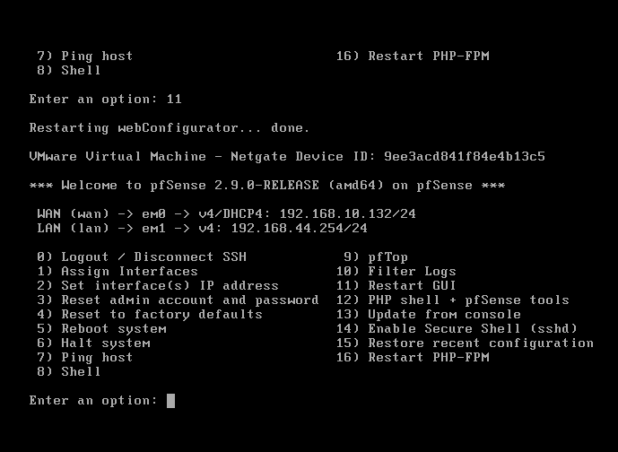
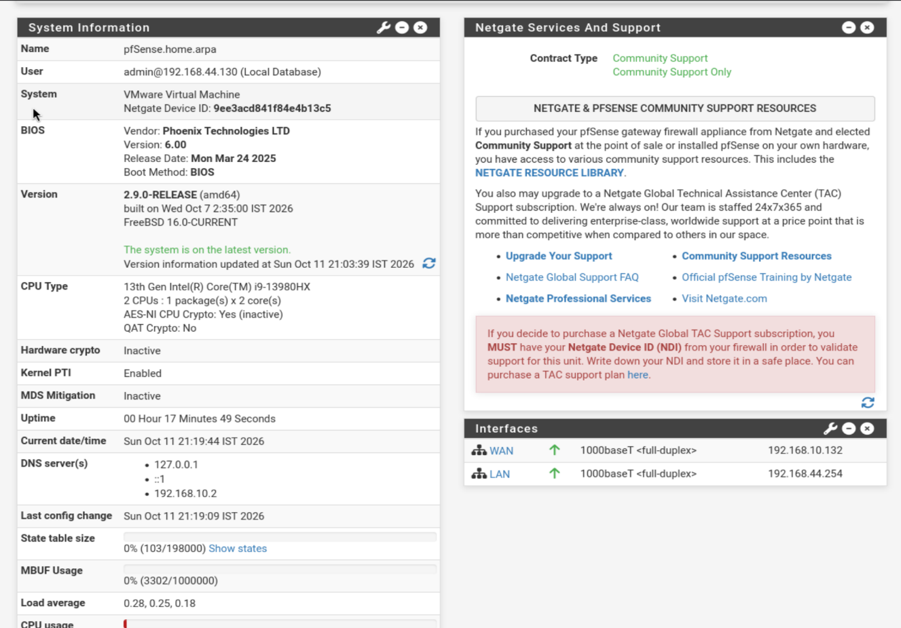
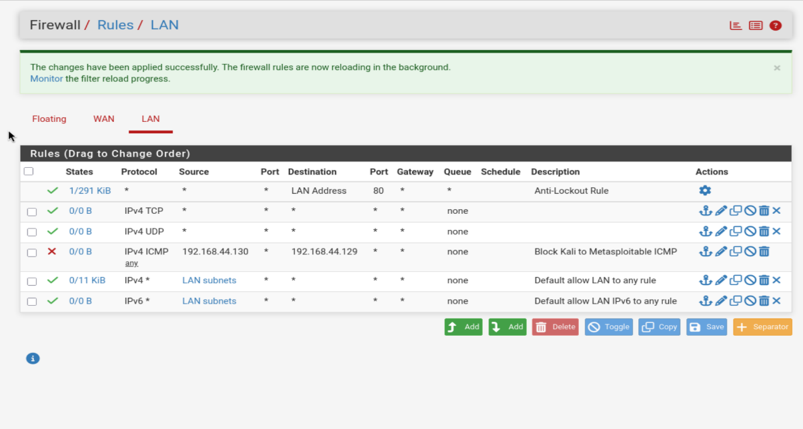
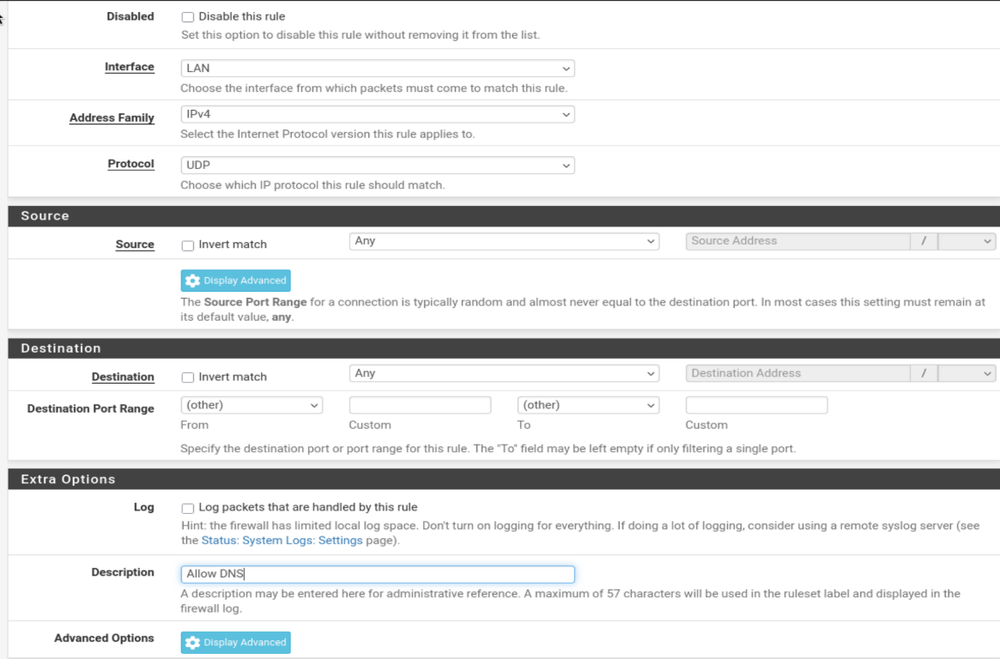
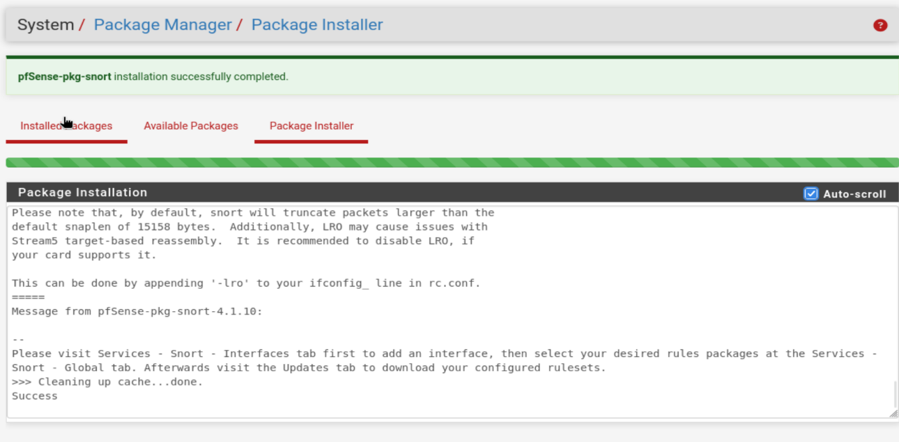
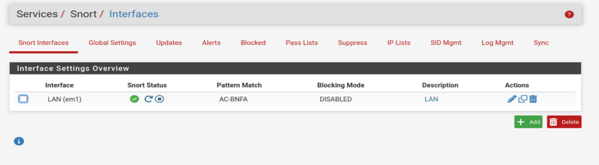
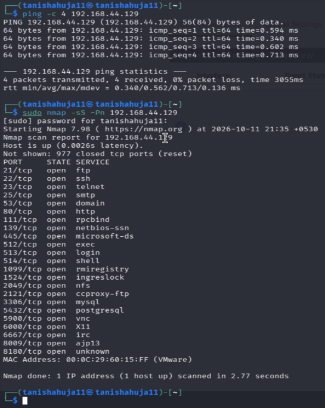

# Experiment 4: Firewall and IDS Setup

## Aim
To configure basic firewall rules in pfSense and configure Snort IDS to monitor network traffic in a controlled virtual lab.

## Objectives
- Check pfSense WAN and LAN interfaces.
- Configure a LAN firewall rule.
- Install Snort and configure it to monitor the LAN interface.
- Generate test traffic from Kali Linux to Metasploitable 2.

## Lab Environment

| Component | Role | Address |
|---|---|---|
| Kali Linux | Testing machine | `192.168.44.130/24` |
| Metasploitable 2 | Lab target | `192.168.44.129/24` |
| pfSense WAN | NAT-side interface | `192.168.10.132/24` |
| pfSense LAN | Lab-side interface | `192.168.44.254/24` |
| VMware VMnet1 | Host-only network | `192.168.44.0/24` |
| VMware VMnet8 | NAT network | `192.168.10.0/24` |

Perform these tests only in your own isolated lab.

## Procedure

### Step 1 — Verify pfSense interfaces
Start pfSense and confirm WAN and LAN are assigned and up. The current addresses are WAN `192.168.10.132/24` and LAN `192.168.44.254/24`.



### Step 2 — Access the pfSense web configurator
In Kali's browser, open `http://192.168.44.254` and log in. The dashboard should show WAN and LAN status.



### Step 3 — Configure LAN firewall rules
Open **Firewall → Rules → LAN**. Configure the required rule, select its protocol, source, destination and action, then save and apply changes. Check rule order because pfSense evaluates rules in order.

The rules screenshot shows a rule labelled **Block Kali to Metasploitable ICMP**. The separate DNS-rule form is an in-progress form and is not proof that the rule was saved.





### Step 4 — Install Snort
Go to **System → Package Manager → Available Packages**, find `snort`, and install it. Wait for the success message.



### Step 5 — Configure Snort on LAN
Go to **Services → Snort → Interfaces** and add/configure the LAN interface (`em1`). Configure and update the desired rulesets under Snort's settings, then confirm that Snort is running.

The screenshot shows **Blocking Mode: DISABLED**, so this setup is operating in IDS monitoring mode rather than blocking detected traffic.



### Step 6 — Generate test traffic
From Kali, run:

```bash
ping -c 4 192.168.44.129
sudo nmap -sS -Pn 192.168.44.129
```

The screenshot shows successful ping replies and Nmap scan results.



### Step 7 — Check Snort alerts
Open **Services → Snort → Alerts**, select the LAN interface, and inspect the log after generating traffic. If no alerts appear, verify that Snort is running, rulesets are downloaded/enabled, and the correct interface is selected. Not every scan necessarily triggers an alert.

## Result
pfSense interfaces were configured, a LAN firewall rule was created, Snort was installed and configured on the LAN interface, and test traffic was generated from Kali Linux to Metasploitable 2.

## Conclusion
The experiment demonstrates basic firewall rule configuration and IDS setup using pfSense and Snort in an isolated virtual lab. Verify firewall behavior against the saved rule order and document IDS detection using the Snort Alerts page.

## Tools Used
Kali Linux, Metasploitable 2, pfSense CE, Snort IDS, VMware Workstation and Nmap.
