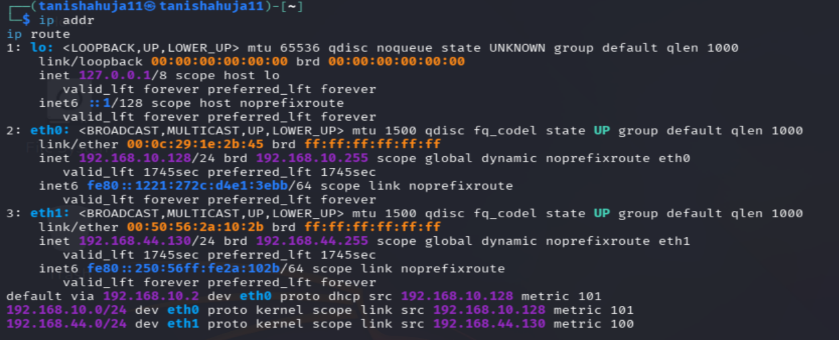
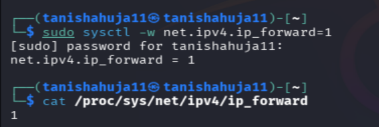
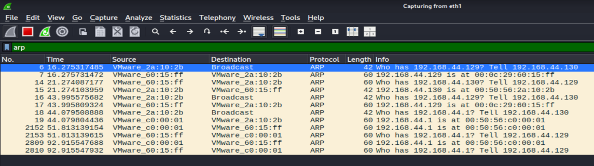
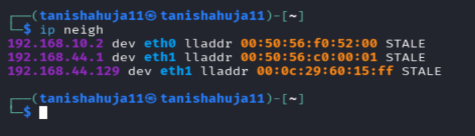
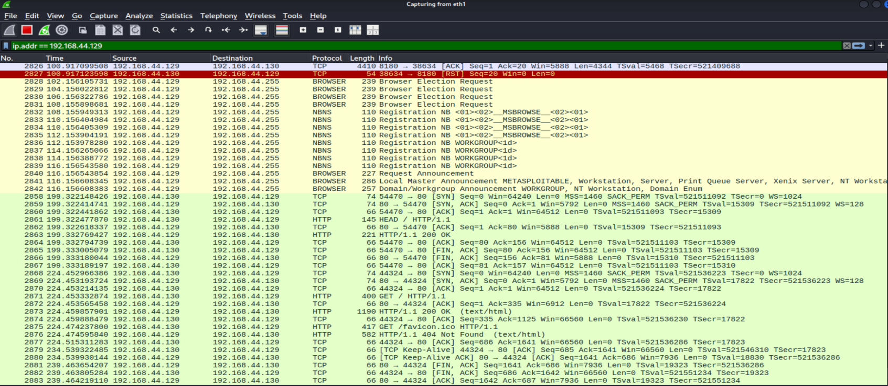
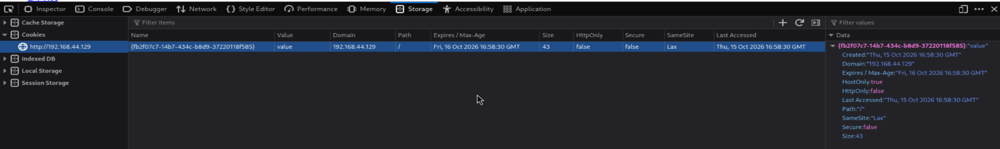

# Experiment 5: ARP Spoofing and Session Hijacking

## Aim
To study ARP spoofing and session hijacking concepts by capturing network traffic and examining session-cookie attributes in a controlled virtual lab.

## Objectives
- Verify the Kali Linux and Metasploitable 2 lab network configuration.
- Capture ARP requests and replies using Wireshark.
- Inspect IP-to-MAC address mappings.
- Generate and inspect HTTP traffic.
- Examine browser cookie attributes and understand session-security risks.

## Requirements
- Kali Linux
- Metasploitable 2
- Wireshark
- VMware Workstation or VirtualBox
- A web service accessible on the isolated lab network

## Lab IP configuration
- Kali `eth0` (NAT): `192.168.10.128/24`
- Kali `eth1` (isolated lab): `192.168.44.130/24`
- Metasploitable 2: `192.168.44.129`
- pfSense LAN, if used: `192.168.44.254`

> **Safety:** Keep testing inside the isolated lab or on systems for which you have explicit authorization.

## Procedure

### Step 1 — Network setup
On Kali, check interfaces and routes:

```bash
ip addr
ip route
```

Confirm that `eth1` is connected to the isolated lab network.



### Step 2 — Enable IPv4 forwarding
On Kali, run:

```bash
sudo sysctl -w net.ipv4.ip_forward=1
cat /proc/sys/net/ipv4/ip_forward
```

The expected value from the second command is `1`.



### Step 3 — Capture ARP traffic
Open Wireshark, select `eth1`, start capturing, and apply the display filter:

```text
arp
```

Generate normal lab traffic:

```bash
ping -c 4 192.168.44.129
```

Inspect the ARP requests and replies.



### Step 4 — Inspect IP-to-MAC mappings
Run:

```bash
ip neigh
```

Compare the neighbor-table entries with the ARP packets captured in Wireshark.



### Step 5 — Generate and inspect HTTP traffic
From Kali, request the Metasploitable web server:

```bash
curl -I http://192.168.44.129/
```

In Wireshark, apply this display filter:

```text
ip.addr == 192.168.44.129
```

Inspect the HTTP request and response packets.



### Step 6 — Inspect session-cookie attributes
Open the lab website in a browser. Open Developer Tools and navigate to **Storage/Application → Cookies**. Inspect the `HttpOnly`, `Secure`, and `SameSite` attributes. Use only a lab/test session; do not copy or reuse real session tokens.



### Step 7 — Understand session hijacking
Session hijacking can occur if an attacker obtains or abuses a valid session identifier. HTTPS encrypts traffic in transit; cookie attributes such as `Secure` and `HttpOnly` provide additional protection.

This step is a conceptual security analysis. The included evidence does not demonstrate a successful session hijack.

### Step 8 — Stop capture and restore settings
Stop Wireshark and save the capture as `experiment5.pcapng` if required. Disable forwarding:

```bash
sudo sysctl -w net.ipv4.ip_forward=0
cat /proc/sys/net/ipv4/ip_forward
```

The expected value from the second command is `0`.

## Observations
- ARP requests and replies were visible in Wireshark on the isolated lab interface.
- The neighbor table showed IP-to-MAC mappings for devices on the lab network.
- HTTP traffic between Kali and Metasploitable was captured.
- The inspected cookie showed `HttpOnly=false`, `Secure=false`, and `SameSite=Lax`.

## Result
ARP traffic and HTTP communication were captured and analyzed, and browser session-cookie attributes were inspected.

## Conclusion
The experiment demonstrated ARP traffic observation, IP-to-MAC mapping inspection, HTTP traffic capture, and the importance of session-cookie security. The included screenshots and packet capture document these observations; they do not by themselves prove that a successful ARP-spoofing attack or session hijack occurred.

## Packet capture
The file [`experiment5.pcapng`](experiment5.pcapng) contains the saved Wireshark capture.

## Repository structure
```text
Experiment-5-ARP-Spoofing-and-Session-Hijacking/
├── README.md
├── experiment5.pcapng
└── screenshots/
    ├── 01-kali-ip-and-routing.png
    ├── 02-ip-forwarding-enabled.png
    ├── 03-wireshark-arp-capture.png
    ├── 04-arp-neighbor-table.png
    ├── 05-http-traffic.png
    └── 06-session-cookie-inspection.png
```
