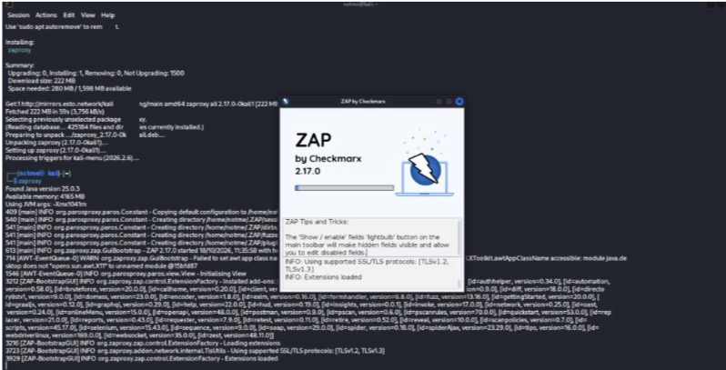
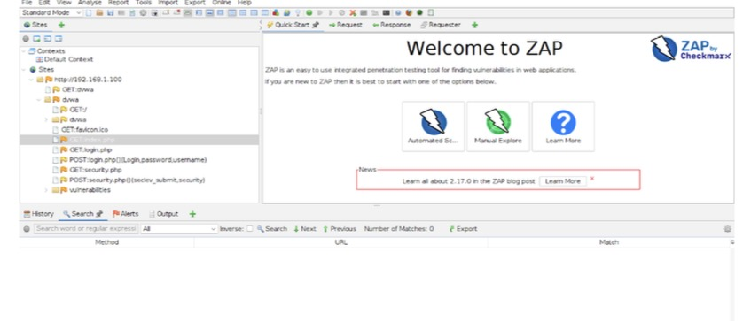
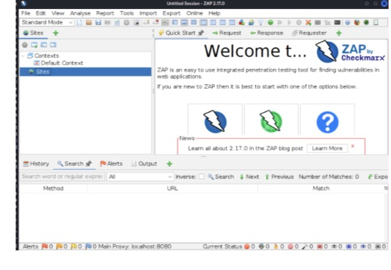
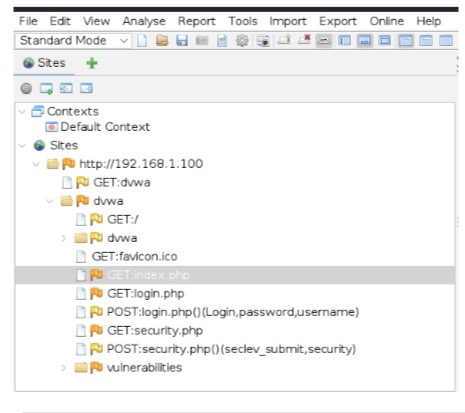
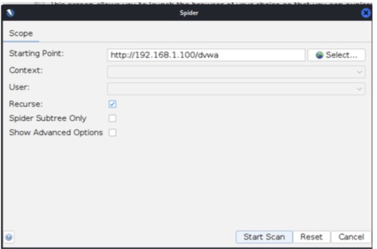
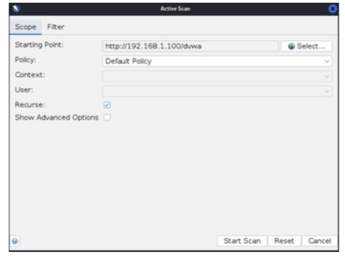
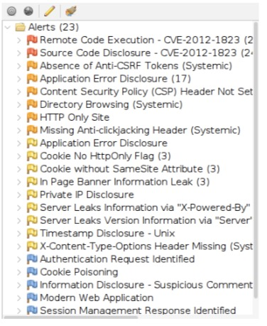
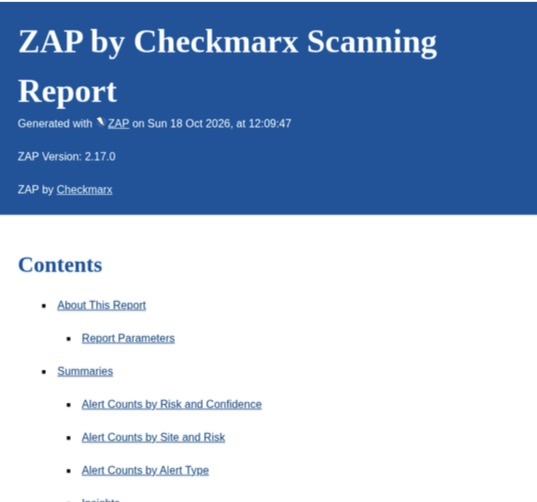
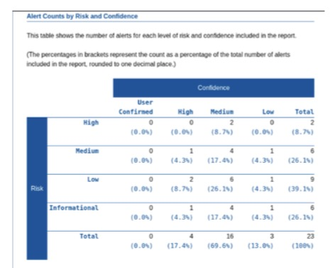

# Experiment 6: DVWA Web Security Assessment Using OWASP ZAP

## Aim
To perform a web-security assessment of DVWA using OWASP ZAP and identify vulnerabilities in an authorized lab environment.

## Requirements
- Kali Linux
- DVWA running on a lab host
- OWASP ZAP
- Web browser
- Isolated virtual lab network

## Target address
The written procedure uses `http://192.168.1.100/dvwa`. Confirm the actual target IP in your current lab before scanning. Your previously used lab network was `192.168.44.0/24`, so do not assume `192.168.1.100` is correct without checking.

## Procedure

### Step 1 — Configure the lab and verify connectivity
On Kali, identify interfaces and routes, then test connectivity to the actual DVWA host:
```bash
ip addr
ip route
ping -c 4 <DVWA-IP>
```

### Step 2 — Open DVWA and set its security level
Open DVWA in the browser, sign in using the lab credentials, and set the security level to **Low** for this deliberately vulnerable training application.

### Step 3 — Install and launch OWASP ZAP
Launch ZAP from Kali. The supplied screenshot shows ZAP 2.17.0 starting.



### Step 4 — Explore the target manually
Browse the authorized DVWA application through the configured browser/proxy so its requests and pages appear in ZAP.





### Step 5 — Verify DVWA pages and the Sites tree
Confirm the target pages and requests appear in ZAP's Sites tree.



### Step 6 — Run the Spider
In ZAP, open the Spider dialog for the authorized DVWA target. Set the starting point to the actual DVWA URL and start the scan.



### Step 7 — Run the Active Scan
Run Active Scan only against the deliberately vulnerable DVWA instance in your isolated lab. Use the correct target URL and the default policy unless your lab instructions specify otherwise.



### Step 8 — Review detected vulnerabilities
Review the Alerts tab. The supplied screenshot lists findings including missing security headers, cookie-attribute issues, and information disclosure. Validate findings before treating them as confirmed vulnerabilities.



### Step 9 — Generate and review the report
Generate a ZAP report and review its findings and risk/confidence summary.





## Result
OWASP ZAP was launched and used to explore DVWA, configure Spider and Active Scan operations, review detected alerts, and generate a scanning report. The supplied report summary shows **23 alerts** across different risk and confidence levels.

## Conclusion
The experiment demonstrated a basic web-application security assessment workflow using OWASP ZAP against DVWA in a controlled lab. The results highlight issues requiring review, such as missing security headers and cookie settings. Findings should be manually validated before being treated as confirmed vulnerabilities.

## Safety
Only scan DVWA or systems for which you have explicit authorization. Active scanning sends test requests and should not be used against public or production systems without permission.

## Screenshot index
1. `screenshots/01-zap-installation.jpeg` — ZAP startup.
2. `screenshots/02-zap-welcome-screen.jpeg` — ZAP welcome screen.
3. `screenshots/03-zap-sites-tree.jpeg` — discovered DVWA pages.
4. `screenshots/04-zap-alerts-overview.jpeg` — alert list.
5. `screenshots/05-zap-spider-scan-setup.jpeg` — Spider configuration.
6. `screenshots/06-zap-report-generated.jpeg` — generated report.
7. `screenshots/07-zap-sites-tree-detail.jpeg` — Sites tree detail.
8. `screenshots/08-zap-active-scan-setup.jpeg` — Active Scan configuration.
9. `screenshots/09-zap-risk-summary.jpeg` — report risk/confidence summary.
10. `screenshots/10-written-experiment-reference.jpeg` — handwritten procedure reference.
