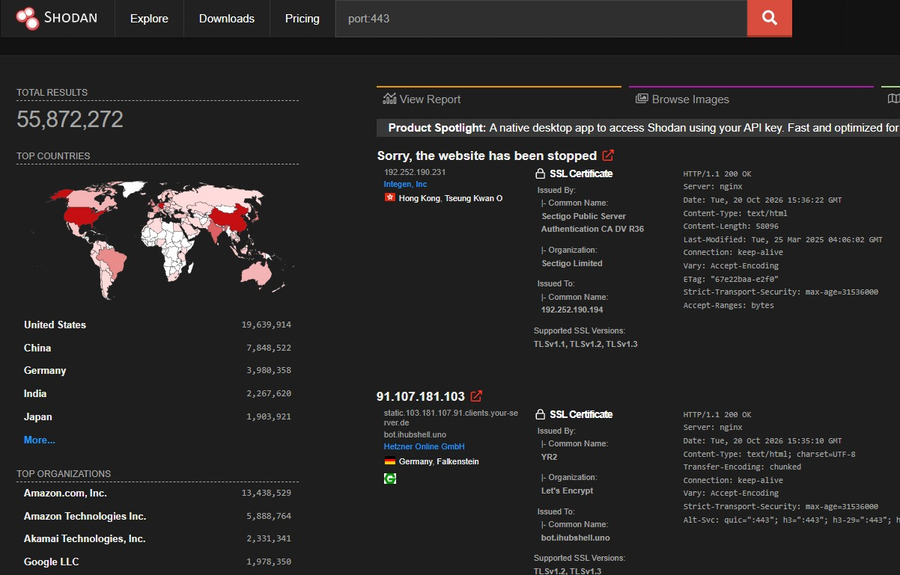
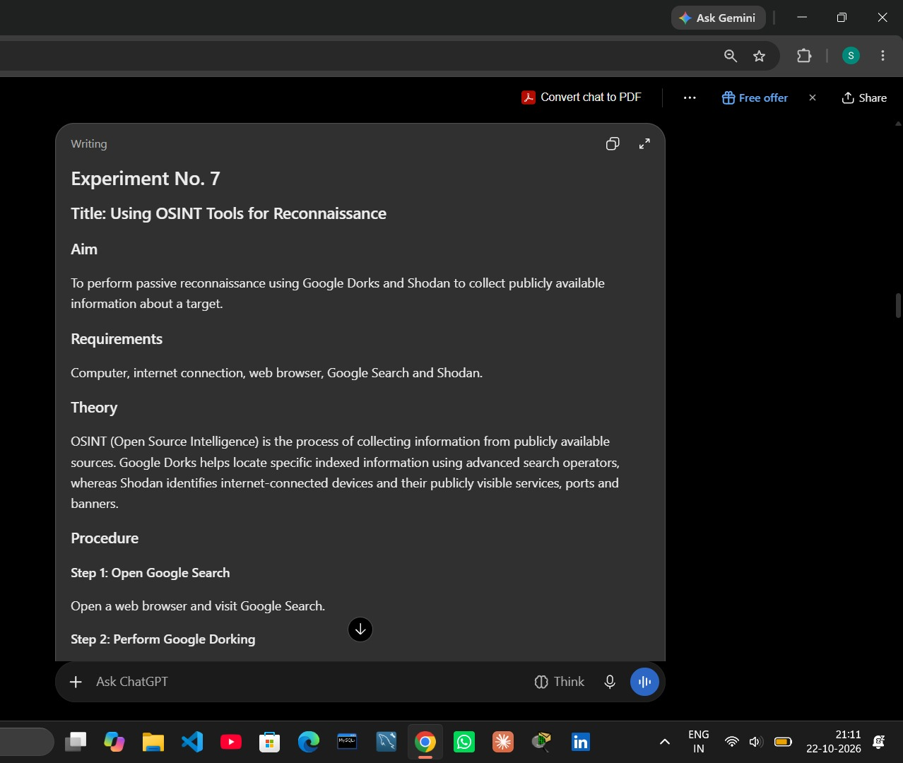
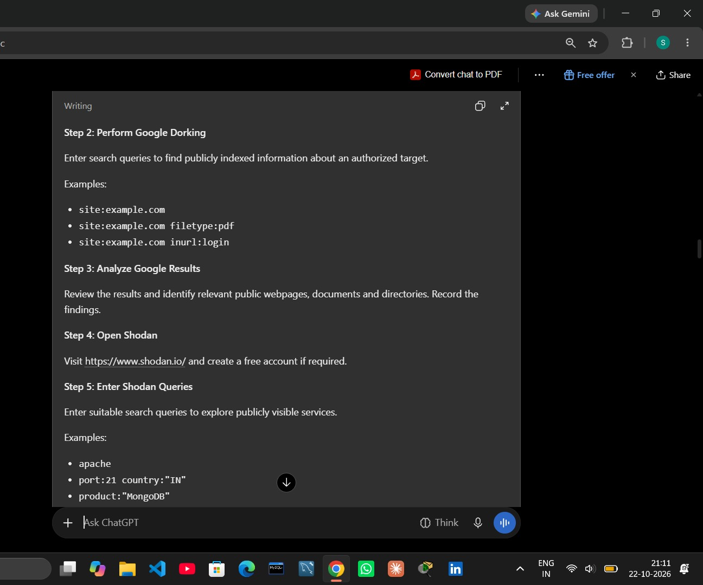
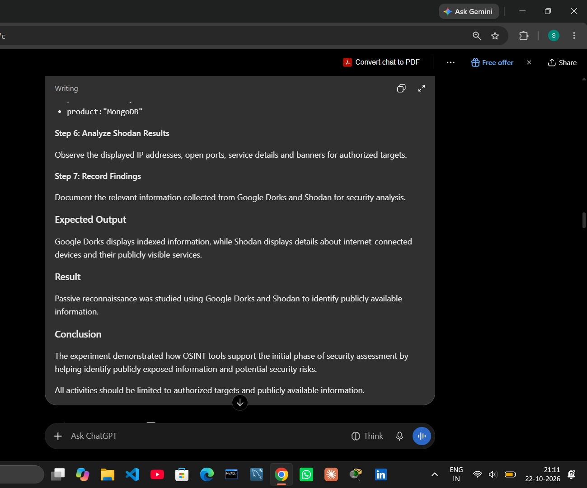

# Experiment 7: Using OSINT Tools for Reconnaissance

## Aim
To perform passive reconnaissance using Google Dorks and Shodan to identify publicly available information about a target.

## Requirements
- Computer with an internet connection
- Web browser
- Google Search
- Shodan

## Theory
Open-Source Intelligence (OSINT) is the process of collecting and analyzing information from publicly available sources. Google Dorks use advanced search operators to locate indexed pages and files. Shodan indexes internet-connected systems and displays publicly visible service information, such as ports, banners, and server technologies.

## Procedure

### Step 1: Open Google Search
Open a browser and visit Google Search.

### Step 2: Perform Google Dorking
Use search operators to find publicly indexed information for an authorized domain. Examples:
- `site:example.com`
- `site:example.com filetype:pdf`
- `site:example.com inurl:login`

Replace `example.com` with a domain you are authorized to assess. The included Google screenshots are demonstrations of search results, not proof of a vulnerability.

### Step 3: Analyze Google results
Review results and record relevant public pages, documents, and directories. Do not attempt to access accounts or data without authorization.

### Step 4: Open Shodan
Visit [Shodan](https://www.shodan.io/) and sign in if required.

### Step 5: Enter Shodan queries
Use search queries to explore publicly visible services. Examples shown in the lab:
- `apache`
- `port:80 apache`
- `port:443`

Run queries only for learning and authorized reconnaissance. Broad searches such as `apache` or `port:443` return many unrelated systems; they do not identify a specific target or prove that any listed system is vulnerable.

### Step 6: Analyze Shodan results
Observe the publicly visible IP addresses, open ports, service banners, and server details. Treat results as a point-in-time view; services and banners can change.

### Step 7: Record findings
Record only relevant information from public sources for the authorized assessment. Avoid collecting or publishing unnecessary personal information or sensitive details.

## Result
Passive reconnaissance was demonstrated using Google Dorks and Shodan. Google search operators returned publicly indexed pages matching the queries, while Shodan displayed internet-facing service metadata such as ports, HTTP responses, and server banners.

## Conclusion
The experiment demonstrated how OSINT tools support the initial phase of a security assessment by helping identify publicly exposed information and internet-facing services. Search results should be verified and interpreted carefully, and reconnaissance must remain within authorized scope.

## Screenshots
- `screenshots/01-shodan-apache-search.jpeg` — Shodan Apache query.
- `screenshots/02-shodan-apache-results.jpeg` — Shodan Apache results.
- `screenshots/03-shodan-port-443-results.jpeg` — Shodan port 443 results.
- `screenshots/04-google-dork-login-search.jpeg` — Google Dork login query.
- `screenshots/05-experiment-7-written-procedure.jpeg` — handwritten procedure reference.
- `screenshots/06-experiment-7-result-and-conclusion.jpeg` — handwritten result and conclusion reference.
- `screenshots/07-shodan-port-80-apache-results.jpeg` — Shodan port 80/Apache results.
- `screenshots/08-google-dork-pdf-search.jpeg` — Google Dork PDF query.
- `screenshots/09-experiment-7-step-2-to-5.jpeg` — handwritten procedure steps.

## Safety and scope
Use OSINT tools only for legitimate educational purposes and authorized assessments. Public visibility does not imply permission to access, probe, or exploit a system.
